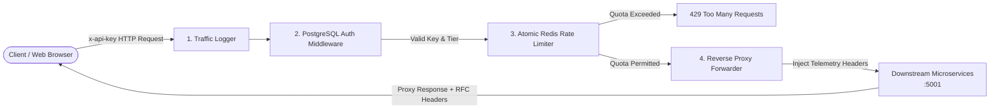

# 🛡️ NexusGateway — API Gateway, Atomic Redis Rate Limiter & Reverse Proxy

A high-performance **API Gateway** and **Distributed Rate Limiter** built with **Node.js, Express, PostgreSQL, Redis, and React (Vite)**. Features multi-tier API key authentication, atomic fixed-window rate limiting, reverse proxy microservice forwarding, and a Cyberpunk SaaS developer dashboard.

---

## 📸 Screenshots & Showcase

### 1. Control Center Overview Dashboard

*Real-time operational KPIs, traffic breakdown across subscription tiers, and visual gateway execution pipeline.*

---

### 2. Interactive Gateway Playground & Burst Rate Limiter

*Live request sender, atomic rate limit quota monitor, RFC-compliant `x-ratelimit-*` headers, and rapid-fire burst simulation triggering 429 blocks with `Retry-After` countdown.*

---

### 3. Client Management & Cryptographic Key Generator

*User provisioning, high-entropy cryptographic key generation (`ak_live_{tier}_{hex}`), and instant key revocation.*

---

### 4. Live Redis Key Inspector & Real-Time Traffic Stream
| Redis Key Inspector | Live Traffic & Latency Stream |
| :---: | :---: |
|  |  |

---

## ⚡ Core Architecture



---

## 🚀 Key Features

* **Multi-Tier Rate Limiting**: Tier-based quota enforcement (`Free: 10 req/min`, `Pro: 60 req/min`, `Enterprise: 1000 req/min`) using a 60-second fixed window backed by atomic Redis `INCR` + `EXPIRE`.
* **Standard Rate Limit Headers** on every gateway response:
  * `x-ratelimit-limit`: Maximum allowed requests per window.
  * `x-ratelimit-remaining`: Requests remaining in the current window.
  * `x-ratelimit-reset`: Seconds until the current window resets.
  * `Retry-After`: Seconds to wait when blocked with `HTTP 429`.
* **PostgreSQL Client Authentication**: `x-api-key` (or `Authorization: Bearer <key>`) validation with B-Tree indexed lookups and instant key revocation.
* **Reverse Proxy Forwarder**: Routes authenticated traffic under `/api/v1/services/*` to downstream microservices, injects telemetry headers (`x-gateway-client-id`, `x-gateway-client-tier`), strips client credentials and hop-by-hop headers, and passes upstream status codes, headers and bodies through untouched. Unreachable upstreams return `502`, slow ones `504`.
* **Resilient Redis**: Uses a live Redis server when available and falls back to an embedded in-memory engine automatically, so the gateway keeps working if Redis goes down.
* **Interactive Cyberpunk / Emerald Dashboard**:
  * Live rate-limiting playground with burst attack simulator.
  * Real-time Redis key scanner & TTL monitor.
  * Real-time incoming traffic & millisecond latency stream.
  * Dual themes: ⚡ **Cyberpunk 2077** & 🌿 **Emerald Matrix**.

---

## 🛠️ Tech Stack

* **Frontend**: React 18, Vite 6, Lucide Icons, Vanilla CSS Glassmorphism.
* **Backend**: Node.js, Express, Axios.
* **Database**: PostgreSQL 15 (`pg` connection pool).
* **Caching & Counters**: Redis (`ioredis`, with in-memory fallback).
* **CI**: GitHub Actions (backend tests against real PostgreSQL + Redis, frontend production build).

---

## 🏁 Quickstart Guide

### 1. Prerequisites
* [Node.js](https://nodejs.org/) (v18+)
* [PostgreSQL](https://www.postgresql.org/) (v14+)
* [Docker Desktop](https://www.docker.com/) for Redis (optional — the gateway falls back to an in-memory engine)

### 2. Install Dependencies
```bash
npm run install:all
```

### 3. Configure Environment
```bash
cp backend/.env.example backend/.env
# then edit backend/.env with your PostgreSQL credentials
```

### 4. Start Redis (Docker, optional)
```bash
docker run -d --name redis-server -p 6379:6379 redis
```

### 5. Create the Database & Seed Default Tiers
```bash
npm run db:migrate
npm run db:seed
```

### 6. Run the Automated Test Suite
```bash
npm run test:all
```

### 7. Start the Backend Gateway & Frontend Dashboard
```bash
# Both at once (Gateway :5000, Upstream Microservices :5001, Dashboard :3000)
npm run dev

# ...or separately
npm run dev:backend
npm run dev:frontend
```

Open **`http://localhost:3000`** in your browser.

---

## 🔑 Seeded Test API Keys

| Tier | Client | API Key | Limit |
| :--- | :--- | :--- | :--- |
| Free | Alice Dev | `ak_live_free_alice_84920482` | 10 req/min |
| Pro | Bob Founder (Pro) | `ak_live_pro_bob_93810294` | 60 req/min |
| Enterprise | Acme Global Corp | `ak_live_enterprise_acme_72819401` | 1000 req/min |
| Free (Revoked) | Revoked Test Client | `ak_live_revoked_key_00000000` | *inactive → 403* |

```bash
curl -i http://localhost:5000/api/v1/services/users -H "x-api-key: ak_live_pro_bob_93810294"
```

---

## 📡 API Reference

| Method | Endpoint | Auth | Description |
| :--- | :--- | :--- | :--- |
| `GET` | `/health` | — | Gateway, PostgreSQL and Redis health |
| `GET` | `/api/public/info` | — | Gateway feature list |
| `POST` | `/api/v1/clients/register` | — | Register a client (`name`, `email`, `tier`) and issue an API key |
| `GET` | `/api/v1/clients` | — | List clients with their tier rules |
| `PATCH` | `/api/v1/clients/:id/toggle-status` | — | Revoke / re-activate an API key |
| `DELETE` | `/api/v1/clients/:id` | — | Delete a client and its rate limit window |
| `GET` | `/api/v1/admin/metrics` | — | Live Redis windows, traffic totals, tier rules |
| `GET` | `/api/v1/admin/logs?limit=&tier=` | — | Recent traffic log entries (max 500) |
| `GET` | `/api/v1/admin/stats` | — | Aggregated traffic metrics |
| `POST` | `/api/v1/admin/ratelimit/reset` | — | Reset one key (`{ "apiKey": "..." }`) or all `ratelimit:*` keys and traffic metrics (`{}`) |
| `GET` | `/api/v1/client/me` | API key | Authenticated client profile + rate limit state |
| `GET` | `/api/v1/gateway/data` | API key | Native gateway data |
| `POST` | `/api/v1/gateway/echo` | API key | Echo the JSON payload |
| `ANY` | `/api/v1/services/*` | API key | Reverse-proxied to `UPSTREAM_URL` |

> ⚠️ The client-management and admin endpoints are intentionally unauthenticated so the local dashboard works out of the box. Put them behind an admin credential or a private network before exposing the gateway publicly.

---

## ⚙️ Configuration (`backend/.env`)

| Variable | Default | Description |
| :--- | :--- | :--- |
| `PGHOST` / `PGPORT` / `PGUSER` / `PGPASSWORD` / `PGDATABASE` | `localhost` / `5432` / `postgres` / `postgres` / `api_gateway_db` | PostgreSQL connection |
| `REDIS_HOST` / `REDIS_PORT` / `REDIS_PASSWORD` | `localhost` / `6379` / — | Redis connection |
| `PORT` | `5000` | Gateway port |
| `UPSTREAM_PORT` | `5001` | Port for the bundled mock microservices |
| `UPSTREAM_URL` | `http://localhost:5001` | Target for `/api/v1/services/*` |
| `UPSTREAM_TIMEOUT_MS` | `10000` | Upstream timeout before returning `504` |

---

## 🧪 Test Suites

`npm run test:all` runs six suites against the real Express app, PostgreSQL and Redis (or the in-memory fallback):

1. **Database & Schemas** — connectivity, tier rules, indexed key lookup.
2. **Security & Authentication** — missing / invalid / revoked keys, Bearer fallback.
3. **Rate Limiter & Headers** — header values, quota exhaustion → `429`, tier isolation, reset.
4. **Reverse Proxy & Traffic Logger** — GET/POST forwarding, telemetry headers, log capture.
5. **Client Registration & Metrics** — key generation, duplicates, revoke, delete, live Redis metrics.
6. **Hardening & Edge Cases** — credential stripping, query forwarding, non-JSON passthrough, `502`/`504`, input validation, malformed JSON, concurrent-burst atomicity, safe flush, in-memory Redis semantics.

Tests clean up the clients they create and only touch their own `ratelimit:*` keys.

---

## 🤝 Contributing

Contributions, issues, and feature requests are welcome! To contribute:

1. Fork the repository
2. Create your feature branch (`git checkout -b feature/amazing-feature`)
3. Commit your changes (`git commit -m "Add amazing feature"`)
4. Push to the branch (`git push origin feature/amazing-feature`)
5. Open a Pull Request

---

## 📄 License
MIT License. Built for high-performance microservice architectures.

