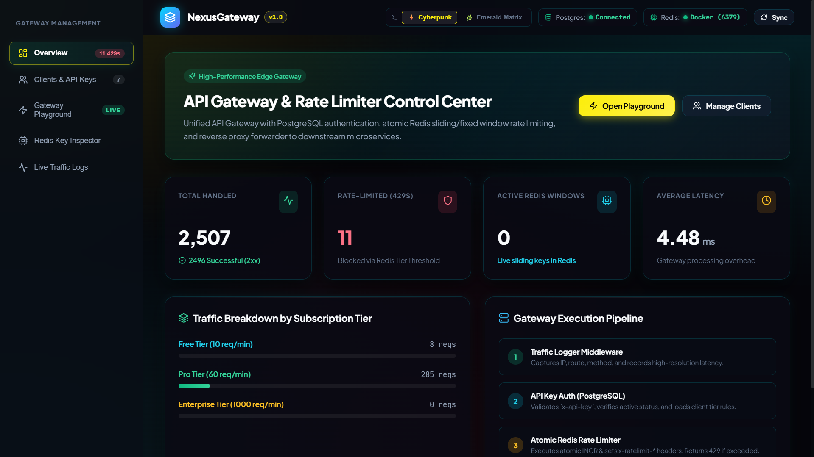
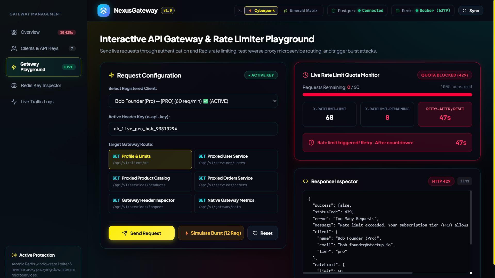
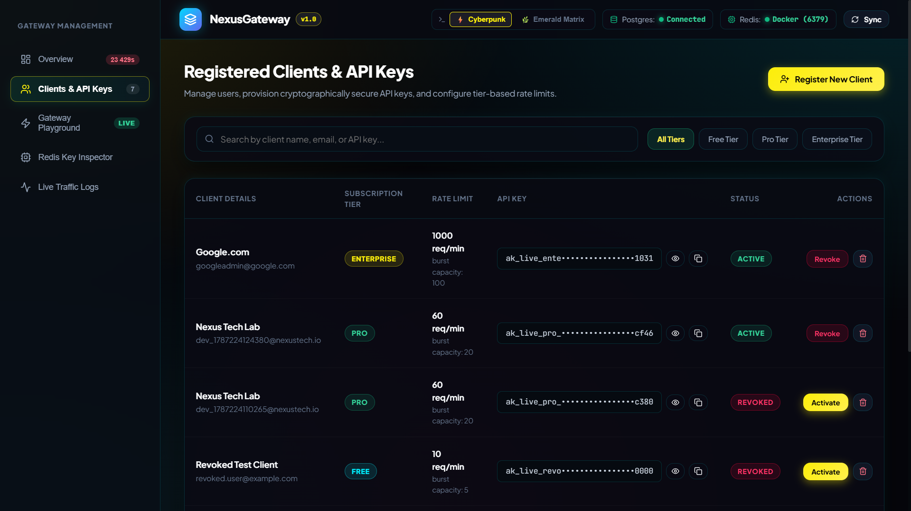
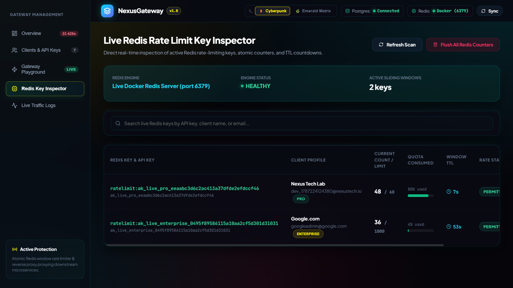
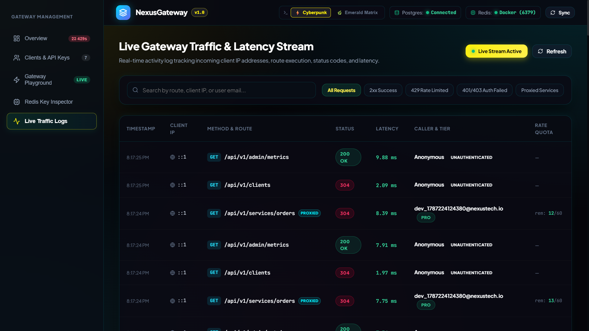

# 🛡️ NexusGateway — API Gateway, Atomic Redis Rate Limiter & Reverse Proxy

A production-grade, high-performance **API Gateway** and **Distributed Rate Limiter** built with **Node.js, Express, PostgreSQL, Docker Redis, and React (Vite)**. Features multi-tier API key authentication, atomic sliding-window rate limiting, reverse proxy microservice forwarding, and a Cyberpunk SaaS developer dashboard.

---

## 📸 Screenshots & Showcase

### 1. Control Center Overview Dashboard

*Real-time operational KPIs, traffic breakdown across subscription tiers, and visual gateway execution pipeline.*

---

### 2. Interactive Gateway Playground & Burst Rate Limiter

*Live request sender, atomic rate limit quota monitor, RFC-compliant `x-ratelimit-*` headers, and rapid-fire burst simulation triggering 429 blocks with `Retry-After` countdown.*

---

### 3. Client Management & Cryptographic Key Generator

*User provisioning, high-entropy cryptographic key generation (`ak_live_{tier}_{hex}`), and instant key revocation.*

---

### 4. Live Redis Key Inspector & Real-Time Traffic Stream
| Redis Key Inspector | Live Traffic & Latency Stream |
| :---: | :---: |
|  |  |

---

## ⚡ Core Architecture


---

## 🚀 Key Features

* **Multi-Tier Rate Limiting**: Tier-based quota enforcement (`Free: 10 req/min`, `Pro: 60 req/min`, `Enterprise: 1000 req/min`) with atomic Redis `INCR` and `EXPIRE`.
* **RFC-Compliant Rate Limit Headers**: Standard HTTP headers injected on every response:
  * `x-ratelimit-limit`: Maximum allowed requests per window.
  * `x-ratelimit-remaining`: Requests remaining in the current window.
  * `x-ratelimit-reset`: TTL remaining (in seconds) until quota resets.
  * `Retry-After`: Seconds to wait when blocked with `HTTP 429`.
* **PostgreSQL Client Authentication**: Secure `x-api-key` validation with B-Tree indexed lookups and instant key revocation support.
* **Reverse Proxy Forwarder**: Routes authenticated traffic to downstream microservices with telemetry header injection (`x-gateway-client-id`, `x-gateway-client-tier`).
* **Interactive Cyberpunk / Emerald Dashboard**:
  * Live rate-limiting playground with burst attack simulator.
  * Real-time Redis key scanner & TTL monitor.
  * Real-time incoming traffic & millisecond latency stream.
  * Dual backend themes: ⚡ **Cyberpunk 2077** & 🌿 **Emerald Matrix**.

---

## 🛠️ Tech Stack

* **Frontend**: React 18, Vite, Lucide Icons, Vanilla CSS Glassmorphism.
* **Backend**: Node.js, Express, Axios.
* **Database**: PostgreSQL 15 (`pg` connection pool).
* **Caching & Counters**: Docker Redis (`ioredis` with in-memory fallback).

---

## 🏁 Quickstart Guide

### 1. Prerequisites
* [Node.js](https://nodejs.org/) (v18+)
* [Docker Desktop](https://www.docker.com/) (for Redis)
* [PostgreSQL](https://www.postgresql.org/) (v14+)

### 2. Start Redis (Docker)
```bash
docker run -d --name redis-server -p 6379:6379 redis
```

### 3. Setup Database & Seed Default Tiers
```bash
cd backend
npm install
npm run db:migrate
npm run db:seed
```

### 4. Run Automated Test Suite (5 Phases)
```bash
npm run test:all
```

### 5. Start Backend Gateway & Frontend Dashboard
```bash
# Terminal 1: Backend Gateway (:5000) & Upstream Microservices (:5001)
cd backend
npm run dev

# Terminal 2: React Dashboard (:3000)
cd frontend
npm run dev
```

Open **`http://localhost:3000`** in your browser.

---

## 📄 License
MIT License. Built for high-performance microservice architectures.
